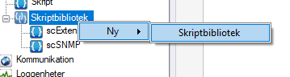
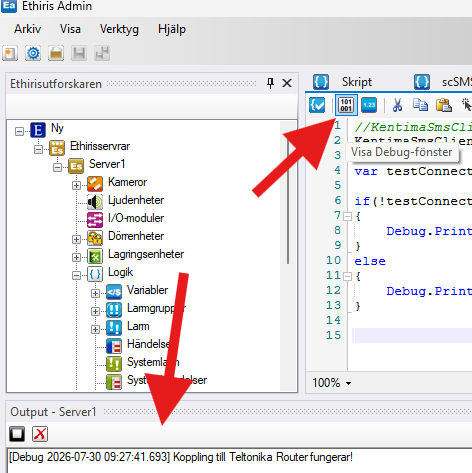

# Skicka SMS med Teltonika – Användning

I detta kapitel beskrivs hur pluginet används i Ethiris för att skicka SMS.

## Skapa ett skriptbibliotek för att konfigurera anslutningen till routern

Det är rekommenderat att skapa ett separat skriptbibliotek för att lägga konfigurationsskriptet i, på så vis säkerställs att skriptet inte krockar med eller påverkar andra skriptfunktioner i huvudskriptet. Eventuell felsökning och uppgradering underlättas också.

1. Skapa ett nytt skriptbibliotek i Ethiris Admin genom att högerklicka på **Skriptbibliotek** -> **Ny** -> **Skriptbibliotek**.

    

2. Ett nytt skriptbibliotek skapas då med namnet *Nytt skriptbibliotek*. Ange ett lämpligt namn för skriptbiblioteket genom att dubbelklicka på skriptbibliotek-noden och mata in det nya namnet. I detta exempel används **scSMS**.
3. Klistra in följande skript:

    ```javascript
    // Stänger av certifikatvalideringen, kan plockas bort om ett giltigt certifikat importeras
    KentimaSmsClient.KentimaSmsClient.RestClient.SetIgnoreCertificateErrors(true);

    // Anger anslutningsuppgifter för routern: url, användarnamn och lösenord.
    KentimaSmsClient.KentimaSmsClient.SmsClient.Configure(_url_, _användarnamn_, _lösenord_);

    // Testar att anslutningen till routern faktiskt fungerar med de angivna uppgifterna.
    var testConnectionStatus = KentimaSmsClient.KentimaSmsClient.SmsClient.TestConnection();

    if(!testConnectionStatus)
    {
        // Anslutningen misslyckades - skriv ut felmeddelandet.
        Debug.Print(KentimaSmsClient.KentimaSmsClient.SmsClient.GetLastError());
    }
    else
    {
        // Anslutningen lyckades.
        Debug.Print("Koppling till Teltonika Router fungerar!");
    }
    ```

    !!! info "Varför krävs SetIgnoreCertificateErrors?"
        Teltonika-routerns webbaserade API använder som standard ett självsignerat certifikat som är utfärdat för ett värdnamn baserat på routerns MAC-adress (t.ex. `Teltonika001122334455`) – inte för den lokala IP-adress (t.ex. `192.168.1.1`) som pluginet ansluter till. Certifikatet är därför varken betrott av serverdatorn eller giltigt för adressen som anropas, vilket gör att .NET:s inbyggda certifikatvalidering annars skulle avvisa anslutningen.

        `SetIgnoreCertificateErrors(true)` stänger av denna validering så att anslutningen ändå tillåts. Nackdelen är att skyddet mot man-in-the-middle-attacker försvinner, men eftersom anslutningen sker mot routern över ett lokalt nätverk anses risken normalt vara acceptabel.

        Vill man slippa stänga av valideringen helt går det istället att skapa ett certifikat som är giltigt för routerns IP-adress, se [Certifikat giltigt för routerns IP-adress](avancerat.md#certifikat-giltigt-for-routerns-ip-adress) under Avancerat.

4. Uppdatera `.Configure()` och mata in korrekt information för routern. Exempelvis:

    | Argument | Värde |
    |----------|-------|
    | url | `https://192.168.1.1` |
    | användarnamn | `sms` |
    | lösenord | lösenordet som sattes i föregående steg |

    !!! warning "Använd https, inte http"
        Anslut alltid till routern via `https://` istället för `http://`, så att inloggningsuppgifter och kommunikation inte kan läsas av utomstående på nätverket. Nyare versioner av RutOS inaktiverar dessutom http som standard och tvingar fram https, så en anslutning via http kan sluta fungera helt efter en firmware-uppdatering.

    !!! note "Configure() är säkert att köra varje cykel"
        Till skillnad från `SendSms()`/`SendSmsWait()` (se varningen längre ner) gör ett upprepat `Configure()`-anrop med oförändrade uppgifter ingenting – funktionen är säker att ha ovillkorad i ett skript som körs cykliskt. Ändras url, användarnamn, lösenord eller modem-id byggs anslutningen om, och eventuella meddelanden som just då ligger kvar i den gamla kön övergivs.

5. Klicka på knappen **Visa Debug-fönster** överst i skriptfönstret för att öppna **Output**-panelen längst ned i Ethiris Admin. Spara sedan konfigurationen så att skriptet körs. Om allt har gått rätt till visas `Koppling till Teltonika Router fungerar!` i Output-panelen.

    

### Val av modem vid flera SIM-kort

`Configure()` finns i två varianter: en som tar tre argument (`url`, `användarnamn`, `lösenord`) och en som tar fyra (samma tre, plus `id`). Exemplet ovan använder tre-argumentsvarianten.

Med tre argument frågar pluginet routern vilket modem som ska användas för att skicka SMS:

- **En router med ett SIM-kort** har bara ett modem att välja mellan. Routern svarar automatiskt med dess ID, och pluginet använder det utan att någon ytterligare konfiguration behövs.
- **En router med två SIM-kort** (t.ex. RUTX-serien) har två möjliga modem, och pluginet kan då inte avgöra automatiskt vilket som ska användas. `GetLastError()` skriver i det läget ut ett felmeddelande som listar namnen på de två modemen.

I det senare fallet behöver `Configure()` istället anropas med fyra argument, där det fjärde är ID:t för det modem som ska användas för utskicket: `Configure(_url_, _användarnamn_, _lösenord_, _id_)`.

Modem-id:t kan även tas fram direkt på routern, via SSH eller CLI-fönstret i webbgränssnittet, med kommandot `ubus call mctl list`.

## Skicka ett SMS med routern

När kommunikationen med routern fungerar går det att skicka SMS. Det finns två funktioner för detta, `SendSms()` och `SendSmsWait()`, som skiljer sig åt i hur de hanterar utskicket:

| Funktion | Beteende |
|----------|----------|
| `SendSms()` | Asynkron. Utskicket läggs till i en kö och skickas när modemet hinner med det, utan att skriptet stannar upp och väntar. Nackdelen är att funktionen inte returnerar något `true`/`false` som visar om utskicket faktiskt lyckades. |
| `SendSmsWait()` | Synkron. Skriptet väntar tills utskicket är genomfört och funktionen returnerar `true` eller `false` beroende på om det lyckades. |

Båda funktionerna tar samma två argument, båda strängar: telefonnummer och den text som ska skickas, t.ex. `SendSms(_telefonnummer_, _text_)`.

!!! note "Format på telefonnumret"
    Telefonnumret behöver inte anges i internationellt format – ett vanligt lokalt nummer fungerar också. Internationellt format (t.ex. `+46701234567`, med landskod och `+`) rekommenderas ändå, för att undvika oklarheter kring vilket land numret hör till.

Text längre än 160 tecken delas upp i flera SMS (standard GSM-segmentering), vilket är värt att ha i åtanke eftersom det kan påverka kostnaden per utskick beroende på operatörens prissättning.

Misslyckas ett köat utskick (`SendSms()`) görs det om ytterligare tre gånger, med 15 sekunders mellanrum, innan det kasseras.

!!! warning "Lägg inte SendSms direkt i huvudskriptet"
    Ethiris huvudskript körs som standard var 150:e millisekund. Ligger anropet till `SendSms()`/`SendSmsWait()` direkt i huvudskriptet körs det alltså om och om igen, vilket leder till ett väldigt stort antal SMS-utskick. Anropet måste istället kopplas till en händelse, t.ex. `onEvent()` eller `onDataChange()`, så att ett SMS bara skickas när den händelsen faktiskt inträffar.

!!! note "Varför fungerar det i scSMS men inte i huvudskriptet?"
    Ett skriptbibliotek som `scSMS` körs bara en gång – vid uppstart av Ethiris Server, eller när konfigurationen sparas – till skillnad från huvudskriptet, som utvärderas cykliskt var 150:e ms. Det är därför ett `SendSms()`-anrop kan ligga direkt i toppen av ett skriptbibliotek utan att skicka SMS om och om igen (se ["Snabbtesta hela kedjan"](#snabbtesta-hela-kedjan) nedan), men aldrig i huvudskriptet.

Välj `SendSmsWait()` om skriptet behöver veta om SMS:et faktiskt skickades, och `SendSms()` om det räcker att lägga utskicket i kö utan att invänta resultatet.

### Snabbtesta hela kedjan

Om man vill kan man lägga till följande skriptrad direkt i `scSMS` (skriptbiblioteket som skapades tidigare):

```javascript
KentimaSmsClient.KentimaSmsClient.SmsClient.SendSms(_telefonnummer_, _meddelande_);
```

Då skickas ett SMS varje gång konfigurationen sparas, vilket låter en snabbt verifiera att hela kedjan – anslutning, autentisering och utskick – fungerar från Ethiris.

!!! note "Plocka bort raden efteråt"
    Ta bort raden igen när testet är genomfört. Ligger den kvar i `scSMS` kommer ett nytt SMS att skickas varje gång konfigurationen sparas.

## Exempel på användning

### Ett enskilt larm

Nedan skickas ett SMS när ett larm, `MittLarm`, går aktivt. En händelselyssnare kopplas till larmets `onStateChange`, och SMS skickas bara när larmets nya tillstånd (`State`) är `3` (aktivt) – precis det flankvillkor som varningen ovan syftar på, snarare än att kontrollera larmets tillstånd i varje cykel:

```javascript
// Händelselyssnare på larmet
MittLarm.onStateChange = function(event)
{
    // Larmet har gått aktivt
    if (event.target.State == 3)
    {
        KentimaSmsClient.KentimaSmsClient.SmsClient.SendSms(_telefonnummer_, "Larmet: " + event.target.Name + " har gått aktivt!");
    }
}
```

### Alla larm i projektet

Samma mönster kan i stället kopplas till `Alarms`-samlingen för att lyssna på alla larm i projektet, istället för ett enskilt larm:

```javascript
// Händelselyssnare på alla larm
Alarms.onStateChange = function(event)
{
    // Har larmet gått aktivt
    if (event.target.State == 3)
    {
        KentimaSmsClient.KentimaSmsClient.SmsClient.SendSms(_telefonnummer_, "Larmet: " + event.target.Name + " har gått aktivt!");
    }
}
```